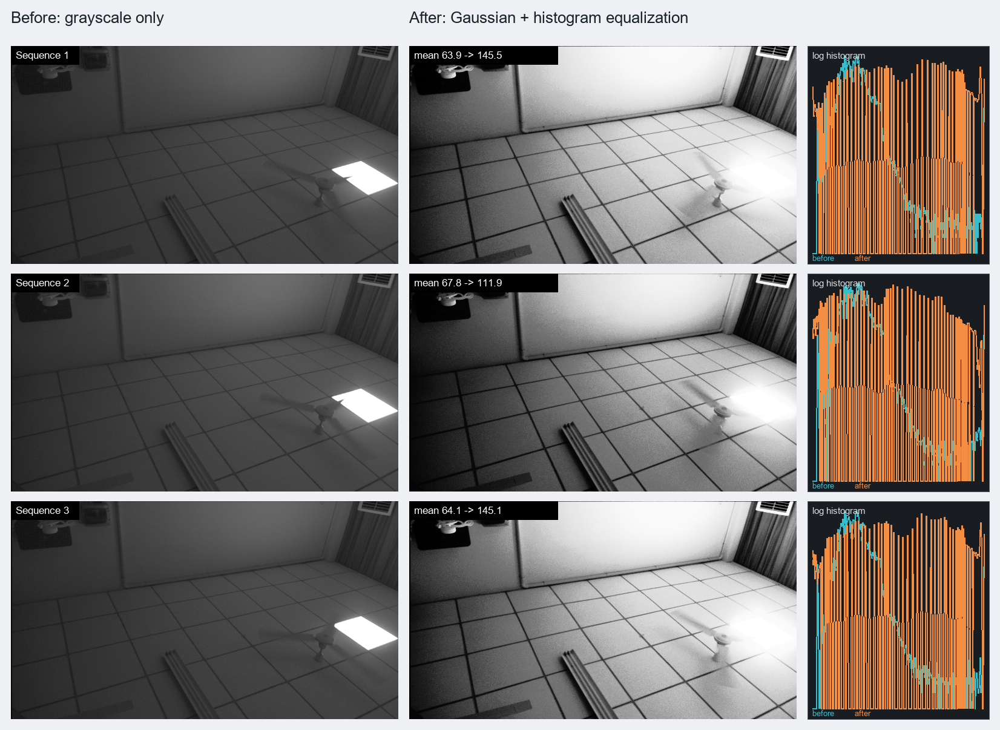

# Preprocessing comparison, 2026-10-03

The RK3576 captured ten complete mode-0 frames and twelve complete mode-3
frames from the same fixed camera scene. Three frames from each set were
downloaded as 640x360 previews by sampling every third pixel in both axes.
Mode 0 is grayscale only. Mode 3 is Gaussian filtering followed by global
histogram equalization.

## Measured result

| Metric, three-frame average | Before | After | Change |
| --- | ---: | ---: | ---: |
| Standard deviation | 28.10 | 73.31 | 2.61x |
| P05-P95 range | 60.33 | 227.00 | 3.76x |
| Mean neighbor difference | 2.29 | 6.02 | 2.64x |
| Entropy | 6.091 bit | 6.030 bit | -1.0% |
| Black pixels | 0.00% | 0.62% | +0.62 percentage points |
| White pixels | 1.23% | 1.20% | nearly unchanged |

The equalized output uses almost the entire 8-bit range. Floor seams, wall
edges, the curtain, and dark objects become much easier to distinguish. The
edge metric rises with local contrast, although visible grain in smooth wall
and floor regions also contributes to that increase. The bright light source
was already clipped before processing and cannot be recovered by histogram
equalization.

Entropy does not increase. The equalization LUT spreads occupied input levels
apart and leaves gaps between output levels, so the result looks stronger but
does not contain more source information. The output is currently aggressive:
some wall and floor areas become very bright and sensor or quantization noise
is more visible.

## Temporal behavior

The unprocessed frame means alternate around 64 and 68 under the current
lighting, a roughly 6% phase difference. Mode 3 alternates around 112 and 145,
roughly 30%. A per-frame histogram LUT therefore amplifies illumination
flicker by about five times in this scene. The alternating brightness is also
visible across the three processed previews.

For a final video demonstration, temporal stabilization should be added before
increasing spatial complexity. A low-cost implementation can smooth the LUT or
histogram across frames and blend the equalized result with the grayscale or
Gaussian path using a programmable strength. Clipped or local histogram
equalization can be considered later if the resource and timing margin remain
adequate.

Raw measurements are stored in `comparison_stats.json`. The FPGA was returned
to mode 3 after capture and the RK HDMI viewer was restarted at 60 FPS.
