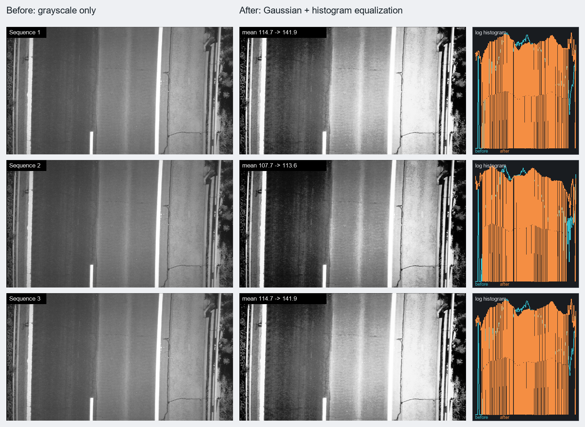

# 新采集的原灰度与直方图均衡画面对比（2026-10-03）

这次从当前摄像头场景重新采集，不复用此前的画面。RK 上直接读取 `/dev/video73`：FPGA 模式 0（原灰度）和模式 3（高斯 + 直方图均衡）各抓取 12 张完整的 1920×1080 GREY8 帧，每组 24,883,200 字节。采集走 V4L2 原始输出，未经过 RK HDMI 去闪滤镜。两组画面来自模式切换前后的相邻时段，**不是同一时刻的同一帧**。

图中三行取自灰度组的第 5、6、7 帧和均衡组的第 6、7、8 帧（均按 1 起始计数）。每组均按亮、暗、亮的相同光照相位排列，减小当前照明交替对模式比较的干扰。每张预览从完整帧的水平和垂直方向每 3 个像素取 1 个，得到 640×360 图。直方图使用对数计数：青色是原灰度，橙色是模式 3。目录下保留每张单图、压缩预览数据及 `comparison_stats.json`。

| 三帧平均指标 | 原灰度 | 高斯 + 直方图均衡 |
| --- | ---: | ---: |
| 灰度标准差 | 41.69 | 73.41 |
| 5%～95% 灰度跨度 | 120.67 | 227.33 |
| 相邻像素平均灰度差 | 5.68 | 8.10 |
| 信息熵 | 7.193 bit | 6.936 bit |

均衡后灰度跨度扩大约 1.88 倍，门框、墙面纹理和暗部层次更显眼。平坦区域的颗粒也被放大，部分亮线接近饱和；信息熵并未增加，说明增强主要是重新分配已有灰度，而非创造新的源信息。当前相机画面存在交替明暗，相位匹配只能减小该因素，不能把两次模式采集变成严格的同帧算法对照。

完成后 FPGA 已切回模式 3，RK HDMI 实时显示程序已恢复。板上的完整原始帧暂存于 `/run/preproc_fresh_gray.gray` 和 `/run/preproc_fresh_equalized.gray`；`/run` 内容会在重启后消失。
