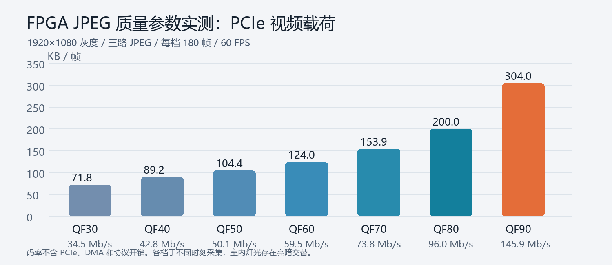
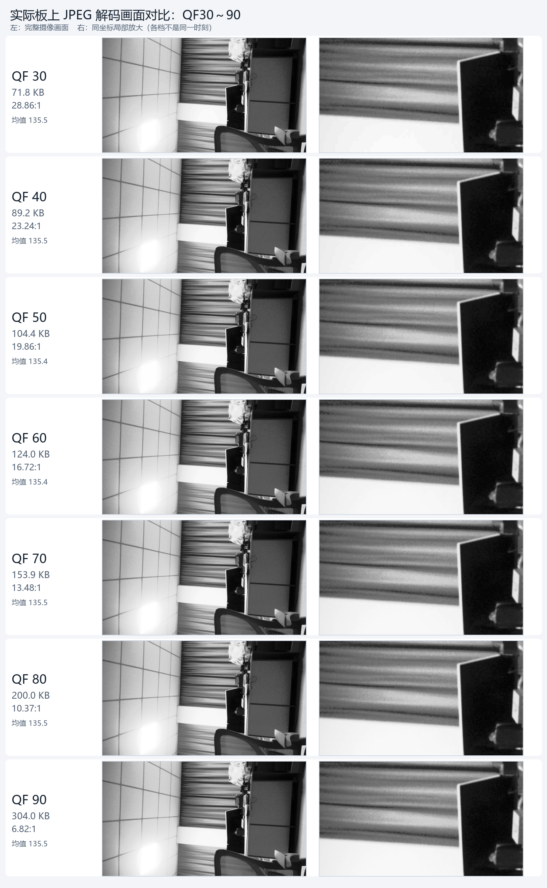
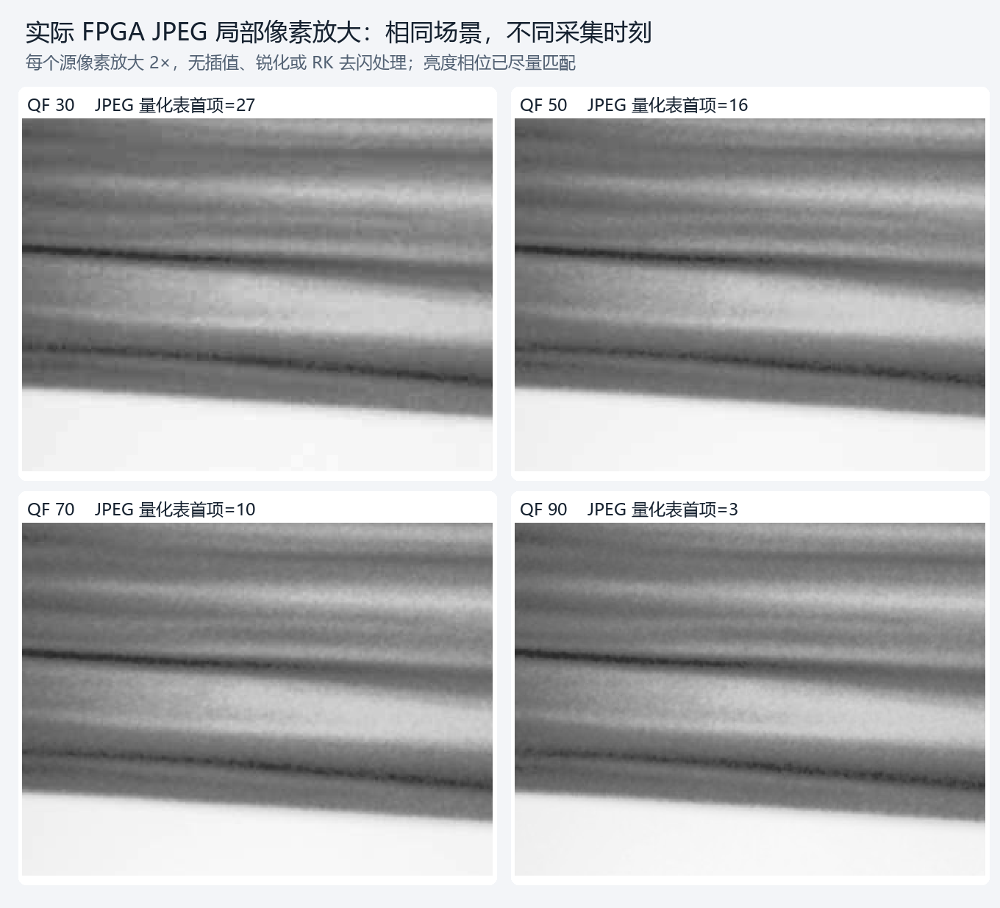

# 新 bit 上板后的 JPEG QF 实测（2026-10-07）

## 测量边界

- 用户已烧录 bit；RK 重新绑定 PCIe 后确认 `JCT1` 控制 ABI、请求与已应用 QF 一致，FPGA 预处理模式 3（高斯＋直方图均衡），三路 JPEG 编码器均就绪。
- 1920×1080、GREY8、60 FPS。每帧分成 A/B/C 三张 1920×360 JPEG，经 C2H1/2/3 传到 RK。表中每帧字节数是三张**完整 JPEG 文件长度之和**，包括各自 JPEG 头部；不包括 PCIe、DMA 和链路协议开销。
- HDMI 查看器暂停期间逐档在线切换 QF；每次确认 `applied QF` 后丢弃 45 组过渡帧，再连续测量 **180 组三路配对帧**。所有档位配对完整、FPGA faults=0。详细原始统计见 `metrics.json`。
- 每档另抓 30 组，从字节数较低的室内灯光亮相位挑一组做画面拼图。各样张的全帧均值约 135.4～135.5，减小灯光相位干扰；它们仍不是同一时刻的同一帧，因此不能据此计算严格 PSNR/SSIM。样张的另一次测量摘要见 `visual_sample_metrics.json`，原始 A/B/C JPEG 也保存在本目录。

| QF | 平均 KB/帧 | 5%～95% KB/帧 | 60 FPS 视频载荷 Mb/s | 相对原始 GREY8 压缩比 | 实收 FPS |
| ---: | ---: | ---: | ---: | ---: | ---: |
| 30 | 71.8 | 70.7～73.1 | 34.49 | 28.86:1 | 60.00 |
| 40 | 89.2 | 87.5～91.0 | 42.84 | 23.24:1 | 60.00 |
| 50 | 104.4 | 102.1～106.7 | 50.10 | 19.86:1 | 60.00 |
| 60 | 124.0 | 121.1～126.9 | 59.52 | 16.72:1 | 60.00 |
| 70 | 153.9 | 150.4～157.3 | 73.85 | 13.48:1 | 60.00 |
| 80 | 200.0 | 195.8～204.2 | 96.00 | 10.37:1 | 59.99 |
| 90 | 304.0 | 298.2～309.9 | 145.94 | 6.82:1 | 59.98 |

原始 GREY8 是 2,073,600 B/帧，按 60 FPS 为 995.33 Mb/s。当前场景 QF90 的 JPEG 载荷约为 QF30 的 4.23 倍。QF80 相对 QF90 减少约 34.2% 的 JPEG 字节数，QF70 减少约 49.4%。这些比例随场景纹理、运动、噪声和照明而变。

## 图像观察与建议

拼图由板上实际 A/B/C JPEG 解码并按 8 行交织重建，未经过 RK 去闪滤镜；左侧为全画面，右侧为完全相同坐标的局部区域。用户指出各 QF 肉眼区别不大，这与逐像素 2 倍放大图一致：**在当前较平滑的室内场景中，即使 QF30 与 QF90 的码流相差约 4.23 倍，视觉差异仍很小**。先前将 QF30 描述为“明显较软”、据此推荐 QF80，证据不足。

逐档从 JPEG 文件读取的亮度量化表首项分别为 QF30→27、40→20、50→16、60→13、70→10、80→6、90→3，确认编码量化强度确实变化；这不能单独衡量可见画质或裂缝识别效果。高 QF 保留的额外数据也可能主要是噪声和对当前任务无用的纹理。当前场景不能确定最佳 QF，尤其不能把跨时刻样张做像素级 PSNR/SSIM。下一轮应使用真实道路裂缝样本，并在每个 QF 下同时取得原始 GREY8 参考帧，比较细裂缝的边缘连续性与检测召回率。QF80 可保留为保守参考，同时重点验证 QF50/60/70 是否已足够。

测试结束时已恢复原 QF85、预处理模式 3 和 RK HDMI 实时查看器。JPEG 接收为约 60 FPS；HDMI 图层更新率需要单独看查看器日志，不能用接收 FPS 代替。
