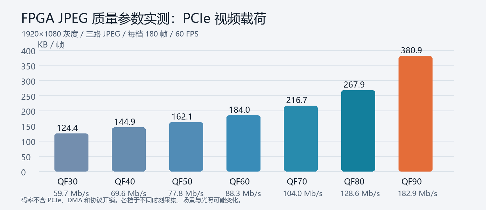
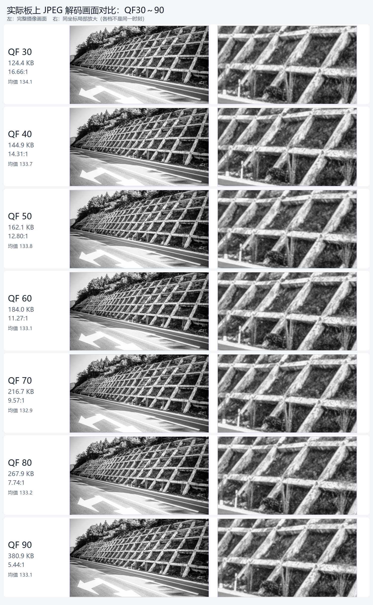

# QF30～90 第二轮板测（2026-10-07）

本轮摄像头画面显示道路、护坡和植被，比[第一轮室内画面](../qf_sweep_20261007/README.md)有更多纹理。右侧放大的是同坐标护坡区域；另留存[路面区域对比](road_crop_comparison.png)。这些是 FPGA 三路 JPEG 经 RK 解码、8 行交织重建后的实际画面，未经过 RK 去闪滤镜。各档在不同时间采集，不能当作严格同帧的 PSNR/SSIM 对照。

## 方法

先暂停 HDMI 查看器，保持 FPGA 模式 3（高斯＋直方图均衡）和 JPEG 60 FPS。逐档设置 QF30/40/50/60/70/80/90，确认 `JCT1` applied 回读，丢弃 45 组切换过渡帧，再连续接收 **180 组三路配对 JPEG**。均值是每组 A+B+C 三个完整 JPEG 文件的字节总和，包含 JPEG 头部，不含 PCIe/DMA 协议开销。每档保存 1 组较低字节数的亮相位样张；全帧均值约 132.9～134.1。详细原始数字与回读状态见 `metrics.json`。

| QF | 平均 KB/帧 | 5%～95% KB/帧 | 60 FPS 视频载荷 Mb/s | GREY8 压缩比 | 实收 FPS | 对比第一轮大小变化 |
| ---: | ---: | ---: | ---: | ---: | ---: | ---: |
| 30 | 124.4 | 122.8～125.5 | 59.73 | 16.66:1 | 60.00 | +73.2% |
| 40 | 144.9 | 143.9～145.8 | 69.56 | 14.31:1 | 59.99 | +62.4% |
| 50 | 162.1 | 159.4～163.9 | 77.79 | 12.80:1 | 60.00 | +55.2% |
| 60 | 184.0 | 182.5～185.4 | 88.34 | 11.27:1 | 59.99 | +48.4% |
| 70 | 216.7 | 215.1～218.2 | 103.99 | 9.57:1 | 60.00 | +40.8% |
| 80 | 267.9 | 265.1～270.3 | 128.57 | 7.74:1 | 59.99 | +33.9% |
| 90 | 380.9 | 377.0～384.2 | 182.86 | 5.44:1 | 59.99 | +25.3% |

各档均收到 180 组配对帧、`requested=applied`、FPGA `faults=0`。同一 QF 的数据量随场景明显变化；第一轮与本轮不能直接用于判断滤波或固件优劣。原始 1920×1080 GREY8 是 2,073,600 B/帧、60 FPS 为 995.33 Mb/s。本轮 QF90 平均载荷约为 QF30 的 3.06 倍。

## 观察和显示状态

在当前道路与护坡画面中，QF 越高细纹理保留越多，但缩小后的整帧仍不容易肉眼区分。画面中没有已标注的细裂缝，也没有每档同帧原始灰度参考，因此**不能据此选出道路裂缝识别的最优 QF**。下一步应在含已知裂缝宽度的画面上测裂缝边缘连续性和检测结果。

测试后已恢复原 QF85、模式 3 和 HDMI 实时查看器。恢复后约 35 秒日志：三路收到约 2,098 帧并重建 2,098 帧，平均约 59.91 FPS；HDMI 图层平均约 54 FPS，显示队列累计溢出约 200 次。故障计数仍为 0。**JPEG 接收 60 FPS 不等于 HDMI 实际稳定显示 60 张不同图像。**
