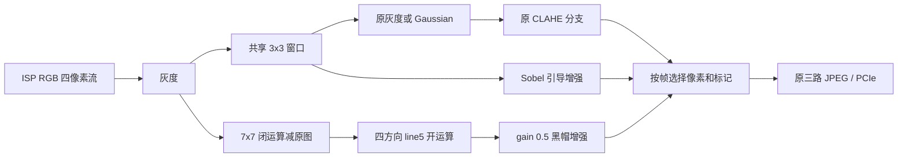

# FPGA 并行增强流水线 EHP1

## 目标与状态

在现有 PH1A90SEG324-2 JPEG 工程中保留 Gaussian/CLAHE，增加 Sobel 引导增强和方向滤波黑帽。三个分支同时计算，按帧选择其中一路送入现有 JPEG/PCIe 通路；不新增三套视频传输，不改变独立 DSI 显示路径。尚未生成或烧录新 bit，也未修改 RK 运行环境。

## 当前资源基线

基线来自 `fpga_prj_jpeg_Runs/phy_1/fpga_prj_jpeg_phy.area` 和同目录 `final_timing.rpt`，时间 2026-10-09 00:13。`tools/preproc_histfix_*` 是较早的灰度工程结果，不能用来评估当前三路 JPEG 工程。

| 资源 | 现有布局布线结果 | 总容量 | 占用 |
| --- | ---: | ---: | ---: |
| LUT6 | 37,953 | 64,320 | 59.01% |
| Slice | 44,571 | 64,320 | 69.30% |
| Slice 寄存器 | 43,517 | 128,640 | 33.83% |
| ERAM20K | 243 | 272 | 89.34% |
| DSP | 110 | 240 | 45.83% |
| 分布式 RAM LUT | 6,584 | 计入 Slice | |

现有 setup WNS +0.118 ns、hold WNS +0.020 ns；200 MHz JPEG 时序余量很小。相机处理时钟约 90.025 MHz，其 setup WNS +0.886 ns。新增逻辑即使综合能装下，也必须再次布局布线才能确认时序。

## 算法与硬件结构



- 原分支：原始灰度 / Gaussian / CLAHE / Gaussian+CLAHE，模式 0～3。Gaussian 只保留一份，输出额外的原始 3×3 窗口供 Sobel 共用。
- Sobel：采用之前软件的 T1、gain 0.5 参数，`G=(abs(Gx)+abs(Gy))/8`、`D=clip(I-Mean3x3,-32,32)`、`W=clip((G-1)/12,0,1)`，输出 `round_even(clip(I+0.5*W*D,0,255))`。RTL 用精确整数分数计算，避免提前截断细节项。
- 黑帽：`B=close(I,square7)-I`；对 B 做水平、竖直、正对角、反对角长度 5 的灰度开运算，四路取最大值；输出 `round_even(clip(I-0.5*filtered_B,0,255))`。与选定的 `line5_k7_g0.5` 一致，不在前面叠加 Gaussian。
- 所有图像边界采用复制边界。7×7 闭运算拆成水平/竖直 min/max；方向窗口共享。所有极值归约使用平衡比较树，方向膨胀和四路合并分为两级。黑帽原图对齐 FIFO 和部分方向平面使用 LUT RAM，节省 ERAM。
- 每拍输入/输出 4 个像素，支持 valid 空隙。无整帧缓存、无输入反压。输出像素和 SOF/EOL 一起选择；原模式保持原来的流水线延迟，不为短分支增加统一延迟 FIFO。

黑帽约需 10 行的前视与帧尾排空，帧间应留至少 `10*(1920/4)+64=4864` 个相机时钟的空隙，约 54.0 us。若下一帧到来时黑帽上一帧尚未排空，粘滞故障位会置 1；这是选择器安全切帧的前提。全流水线吞吐设计支持 1080p60，但不能把 RTL 仿真或门级估算当作上板 60 FPS 测量。

处理发生在 FPGA 的 1920×1080 灰度图上。此前软件样张上的 640 尺度与原始相机分辨率可能不同，K7 的实际空间尺度需要烧录后用同一画面比较。当前只验证算法与数据通路，未证明 YOLO 召回率提升。

## 模式与控制

| 编号 | 模式 | RK 脚本参数 |
| ---: | --- | --- |
| 0 | 灰度 | `gray` |
| 1 | Gaussian | `gauss` |
| 2 | CLAHE | `clahe` |
| 3 | Gaussian+CLAHE，复位默认 | `gauss-clahe` |
| 4 | Sobel 引导增强 | `sobel` |
| 5 | 方向滤波黑帽 K7 gain0.5 line5 | `blackhat` |

BAR0：0xA4 请求模式，0x100 实际应用模式，0xAC 算法标记 `0x45485031`（EHP1），0x104 模式支持位图 `0x3f`；0xA8 bit0 汇总窗口排空、FIFO、帧重叠故障。模式在输入帧 SOF 锁存，帧中途修改请求在下一帧生效。原 ABI、QF/JPEG/DMA 控制保留。

新 bit 烧录后，将本工程 `deploy/preproc_mode.py` 更新到 RK 再运行：

```bash
python3 preproc_mode.py status
python3 preproc_mode.py sobel --wait-applied
python3 preproc_mode.py blackhat --wait-applied
python3 preproc_mode.py gauss-clahe --wait-applied
```

## 验证入口

已通过：工程清单/AST/端口检查、内存 BAR 控制检查、13 帧像素参考仿真，以及最终同步行缓存版的两帧完整 1080p 仿真。日志分别为 `sim/ehp1_small.log`、`sim/ehp1_1080p.log`。

黑帽与 OpenCV 黄金结果完全一致；Sobel 精确分数与软件 float32 在舍入临界点最多相差 1 灰度级。旧模式 0～3 与独立 Gaussian/CLAHE 参考通路一致。最终平衡树版完整 1080p 共检查 4,147,200 像素、1,036,800 个四像素拍，无丢失/额外拍、无标记错误、无故障。正常持续吞吐均为 4 像素/拍。首像素延迟为 Sobel 489 拍（约 5.43 us）、黑帽 4824 拍（约 53.59 us）。

- `tools/check_sources.py`：工程登记、语法和本地模块端口检查。
- `tools/prepare_enhance_vectors.py` + `sim/tb_gray_enhance4.sv`：13 帧、全部模式及非法模式；OpenCV 像素参考、独立旧分支参考、随机纹理、复制边界、valid 空隙和帧中请求切换。
- `sim/tb_gray_enhance4_1080p.sv`：Sobel/黑帽各一帧，1920×1080 无行间空隙连续输入，检查全部 1,036,800 个四像素拍、像素值、帧行标记和故障。
- `tools/check_enhance_control.py`：内存 BAR 模拟，确认 EHP1 新模式、CLH1 兼容和旧位流拒绝新模式，无设备访问。
- `tools/td_enhance_synth.tcl`：完整顶层综合，候选报告单独写在 tools 下。最终资源与时序结论见下节。

## 手动实施

TD 打开 `fpga_prj_jpeg.al`，顶层 `system_top`。CLAHE、Sobel 和黑帽及其辅助模块定义均位于已登记且启用综合的 `uisrc/01_rtl/gray_preprocess4.v`，无需添加额外源文件。`gray_enhance_stream4.v`、`gray_sobel_guided4.v` 仅保留兼容路径注释，不再定义模块。

2026-10-09 20:03 的 GUI 综合在展开阶段报 `HDL-8007`：Sobel/黑帽是 black box。该次 `.al` 和 GUI 生成的 `.prj` 均缺少两个新增文件的登记；旧 GUI 源文件清单覆盖登记是可能原因。修正采用与现有 CLAHE 相同的源文件组织方式，避免依赖新增清单条目。算法和流水线保持原实现。GUI 清单验证入口为 `tools/td_enhance_gui_synth.tcl`，使用失败时的原 `.prj`，输出单独的 `tools/ehp1_gui_fix_*` 报告。

修复后静态检查通过：106 个工程文件、45 个本地实例端口、126 个未改动的 demo 文件；小尺寸 13 帧像素回归通过，日志 `sim/ehp1_gui_fix_small.log`。合并前后的模块代码逐段核对一致，旧预处理模块也保持原样。使用失败时的 GUI 清单和 `syn_1` 工作目录重新展开及 RTL 优化通过；`tools/ehp1_gui_fix_synth.area` 与此前 `tools/ehp1_synth.area` 的 SHA-256 完全一致（`2D04ECC627C2A5A72636F60754036B4B822F821A16D3E9196F52DBC9BDA63C11`）。

20:38:47 完整门级综合、器件合法化和时序更新通过，命令退出码 0，终端标记 `EHP1_GUI_SYNTH_PASS`，日志 `td_20261009_201742.log` 无 ERROR/black box。最终 Slice 48,848/64,320、寄存器 46,528/128,640、ERAM 256/272、DSP 122/240；门级及合法化后资源报告均与此前成功候选的文件哈希一致。综合时序仍为整机 SWNS -0.917 ns、STNS -213.074 ns、HWNS 0，结果与此前候选相同；尚未完成布局布线或板测，未生成或烧录新 bit。

在 TD GUI 中重新运行 Synthesis，从 read_design 开始；历史红色失败状态不会被这次独立命令行验证自动清除。无需添加兼容 stub 文件。接着运行布局布线，检查最终 setup/hold 后再生成 bit。验证脚本会在工作目录生成 TD 自身的 QoR 辅助文件，但未替换原 GUI 的主资源/时序报告和运行数据库。

完成综合、布局布线后，检查 ERAM/Slice 不超限，所有相关时钟 setup/hold 无负裕量，再生成并烧录 bit。回读 EHP1、模式反馈和 fault 后，依次测灰度、原模式 3、Sobel、黑帽；回收 JPEG 完整帧数、接收 FPS、HDMI 实际呈现 FPS、fault，以及同场景固定 QF 的样张。原工程 bit 和历史报告未被替换。

## 候选综合结果

第一轮同步行缓存版本完整综合通过：Slice 49,971/64,320、ERAM 256/272、DSP 122/240，资源可容纳。相机 90.025 MHz 的 setup WNS 为 -3.956 ns，最差路径从方向膨胀窗口到四路合并输出，包含七级串行比较/选择，因此进行了平衡比较树和流水级修正。该轮历史证据保存在 `tools/ehp1_pre_balance_gate.area`、`tools/ehp1_pre_balance_gate.timing`，不作为最终时序结论。

最终平衡树版完整综合、器件合法化与时序更新通过，日志 `td_20261009_192646.log` 以 `EHP1_SYNTH_PASS` 结束。门级报告为 `tools/ehp1_gate.area`，合法化后报告为 `tools/ehp1_gate_legal.area`，时序为 `tools/ehp1_gate.timing` / `.ts`，独立综合数据库为 `tools/ehp1_gate.db`。这些文件与历史位流、原 GUI 的 syn_1/phy_1 报告分开保存。

| 资源 | 原工程门级 | 新版门级打包 | 新版器件合法化后 | 容量 |
| --- | ---: | ---: | ---: | ---: |
| Slice 估算 | 39,741 | 50,040 (77.80%) | 48,848 (75.95%) | 64,320 |
| Slice 寄存器 | 42,244 | 46,528 (36.17%) | 46,528 | 128,640 |
| ERAM20K | 240 | 256 (94.12%) | 256 | 272 |
| DSP | 110 | 122 (50.83%) | 122 | 240 |
| 分布式 RAM LUT | 6,584 | 11,016 | 11,016 | 计入 Slice |

这里的原工程门级来自 `fpga_prj_jpeg_Runs/syn_1/fpga_prj_jpeg_gate.area`；开头的 243 ERAM / 44,571 Slice 是原工程最终布局布线结果。不同阶段不能直接作为最终物理资源增量。新版尚有 16 块 ERAM、118 个 DSP 的综合余量，Slice 仍有空间，但 RAM 使用率高，布局布线可能增加资源。

实际映射中，黑帽分支使用 21 ERAM、4,608 个分布式 RAM LUT；Sobel 使用 0 ERAM、12 DSP，共享 Gaussian 窗口。原 Gaussian/CLAHE 分支保留。工具也调整了 JPEG 内部 RAM 的映射方式，因此全工程 ERAM 增量为 16，而不是直接把黑帽 21 块相加。三路 JPEG 仍是 RAM 大户，新版该分支占 110 ERAM；PCIe/SGDMA 占 61 ERAM。

最终门级时序：相机 90.025 MHz setup WNS **+1.071 ns**、STNS 0，估算 Fmax 99.631 MHz；此前黑帽串行比较链造成的 -3.956 ns 已消除。整机 setup WNS **-0.917 ns**，负裕量全部在原 200 MHz JPEG 时钟域。原工程同阶段整体 WNS 为 -0.905 ns，原工程最终布线后为 +0.118 ns。新版尚需布局布线，不能据此宣称 JPEG 时序或板上 60 FPS 已验收。综合 hold WNS 0 不等于最终布线 hold 验证。

结论：**资源容量支持本次并行接入，RTL、像素参考和整帧验证已完成。交付为已综合的源码候选；由用户继续手动布局布线、生成 bit、烧录和同场景验收。** 若最终 200 MHz JPEG 时序出现负裕量，应先解决该时钟域时序，再验收原视频帧率和检测效果。

## 2026-10-09 新位流板测更新

用户完成布局布线并烧录后，已通过 COM12 在 RK3576 实测。回读 EHP1 `0x45485031`、模式位图 `0x3f`，新模式反馈正确。最新物理报告为 Slice 54,257/64,320（84.35%）、ERAM 259/272（95.22%）、DSP 122/240，setup WNS +0.114 ns、hold WNS +0.020 ns。这是布线后数值，与前述综合阶段分开记录。

固定 QF=90，原部署六类灰度640 INT8 RKNN，YOLO interval=2。灰度/高斯/原高斯+CLAHE/Sobel 各取 12 张并执行 25 秒 HDMI+YOLO 测试，均无预处理/JPEG/raw fault。Sobel 视频重建 59.17 FPS、HDMI 实测平均 56.6 FPS、YOLO 28.92 FPS；原高斯+CLAHE 分别为 59.13、56.0、29.30 FPS。本轮短窗口未见 Sobel 明显新增性能损失，严格 60 FPS HDMI 尚未通过。

**黑帽 JPEG 通路板测失败，不能作为已通过部署模式。** 60 FPS/QF90 捕获 A/B/C=[170,0,0]，完整配对帧为0；运行中切换也停滞。30 FPS/QF60 复测仍失败，回读 `bridge_fault=110`、`C_cause=0x8 C_line=354 C_beat=180`、`B_cause=0x8`，对应 B/C JPEG 输入 FIFO full。预处理自身 fault 为0。通过独立 PCIe GREY 通道，五种模式各6张完整图像均能获取并由RKNN推理，因此当前直接故障定位在 JPEG 输入桥/缓存。

`gray_window4` 底边复制排空逐拍输出，黑帽多级窗口尾部可能形成突发；现有 B/C FIFO 容量不足是首要待联仿验证的根因假设。板测已确认 FIFO 溢出，但尚未完成输出节拍整形或缓存深度修复，也未生成下一版 bit。还剩13块 ERAM，扩容前必须核算资源。下一次应使用真实相机行间时序联仿黑帽+JPEG，记录尾部有效拍及 FIFO 水位，再修改、综合和重做板测。

报告、实际处理图、板端识别框、完整日志和指标：
`../road_damage_yolov8n/runs/enhance_board_20261009/REPORT.md`。
图像对比使用实际 FPGA GREY 输出，在 RK 上推理；并非 PC 模拟算法。当前单场景无人工真值，不能据此认定细裂缝召回率提升。测试后恢复模式3、QF90、60 FPS 输入选择及原 HDMI/YOLO 路径，最终三个通路故障寄存器均为0。

## EHP2 共享窗口与组合模式更新

根据后续确认的需求，新增 EHP2 候选：黑帽闭运算改为3x3、gain1，首级膨胀复用 Gaussian/Sobel 的原灰度窗口，保留四方向line5响应滤波。灰度/Gaussian/Sobel/黑帽并行计算，选择一路后通过同一套可开关CLAHE。模式0..5保留编号；新增6=Sobel后CLAHE、7=黑帽后CLAHE。算法标识升级为 `0x45485032`，能力位图为 `0xff`。

JPEG联仿首轮复现C路输入FIFO满（cause8、line355）。水平前瞻把行末最后一拍推迟到下一行开始，导致只统计EOL之后的空隙会漏计真实行间隔。EHP2修正为统计同帧所有无效拍间隔，用其最大值安排形态学底边复制排空。原Gaussian窗口未修改；源代码不增加相机反压。

模式表、共享范围、RTL/控制脚本、最终验证结果、资源对比及手动烧录步骤统一记录在 [EHP2_SHARED_WINDOW_DEPLOY.md](EHP2_SHARED_WINDOW_DEPLOY.md)。本节保留此前EHP1板测失败记录，EHP2的仿真通过不代表EHP2已经烧录或完成板测。
