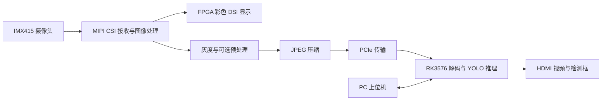
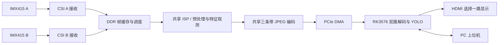

# 基于安路 FPGA 的道路裂缝视觉加速系统

## Brief Introduction
本项目为2026年FPGA嵌入式创新设计大赛安路赛题赛道三的竞赛参与作品。系统为面向无人机场景下对路面裂缝巡检图像的 FPGA-RK3576 异构处理系统。项目采用安路 FPGA 完成双路 MIPI CSI 1080P图像实时采集、HDMI显示屏60FPS稳定输出。自适应应用灰度化/高斯滤波/CLAHE/黑帽变换等硬件预处理方法，以及品质因数可变的 JPEG 压缩自适应调整网络；通过 PCIe 高速通道将图像数据传输至 RK3576，并利用其 NPU 部署 YOLOv8n 目标检测模型，实现在不同退化条件下实时对道路各种裂缝（6种）表观异常的识别和压缩品质、预处理方法自适应适配。系统将通过 HDMI 和千兆网口连接的 PC 上位机显示原始图像、处理结果、检测框及帧率、延迟、压缩率、资源占用等运行参数，以及RK的各种板上资源的利用情况，以及日志的实时存储记录。

本项目面向无人机俯拍道路裂缝检测，结合 **安路 FPGA、IMX415 摄像头和 RK3576**，完成视频采集、图像预处理、JPEG 压缩、PCIe 传输与板端 YOLO 检测。仓库包含两代工程：第一代为单路摄像头加 FPGA DSI 显示，第二代扩展为双路摄像头采集与处理。

> 项目以 1920 × 1080、60 FPS 视频链路为设计目标。实际帧率和延迟受相机输入、图像内容、JPEG 质量、PCIe、RK 解码与推理负载等影响，应以相应位流和现场测试结果为准；视频帧率与 YOLO 推理帧率是两个不同指标。

## 系统架构

### 第一代：单路 CSI + DSI



- 单路 IMX415 采集，FPGA DSI 支路显示彩色相机画面。
- 另一支路提供灰度、高斯、CLAHE、Sobel 引导增强和黑帽等预处理，经过 JPEG 和 PCIe 送往 RK。
- RK 端进行 YOLO 裂缝检测并将结果叠加在 HDMI 视频上；PC 上位机用于控制和查看运行状态。
- DSI 相位、偏色与缩放修正的背景和验证记录见[单路工程说明](<single-channel version_CSI and DSI/FPGA-RTL project/README.md>)及 [DSI 修正记录](<single-channel version_CSI and DSI/FPGA-RTL project/DSI_FIX_20261016.md>)。

### 第二代：双路 CSI



- 两路 IMX415 同时采集；使用 DDR 帧缓存和调度，按帧共享后续处理与 JPEG 资源，分别传输至 RK。
- 支持灰度、高斯、CLAHE、高斯 + CLAHE、Sobel 引导增强、黑帽等模式，按位流能力进行选择；当前双路 Sobel 模式不与 CLAHE 叠加。
- 支持两路 JPEG QF 共享或独立控制，实际可用性取决于已烧录位流和配套软件的能力识别。
- RK 可对两路视频进行 YOLO 检测，HDMI 选择其中一路输出；上位机提供预览、参数设置、状态监控及检测记录等功能。
- 实验性自适应功能使用 FPGA 输出的图像特征，由 RK 上的浅层决策树选择预处理；QF 和 YOLO 资源分配使用暗部比例规则。该功能用于展示，不保证在所有场景提高检测效果。

## 版本对比

| 项目 | 第一代 | 第二代 |
| --- | --- | --- |
| 摄像头 | 单路 IMX415 | 双路 IMX415 |
| FPGA 显示 | 彩色 MIPI DSI | 取消 FPGA DSI，使用第二路 CSI 输入 |
| 视频传输 | JPEG 经 PCIe 发送至 RK | 双路帧缓存、共享处理及 JPEG 后经 PCIe 发送 |
| RK 显示 | HDMI 显示视频及检测结果 | HDMI 在两路视频中选择一路显示 |
| 控制方式 | PC/RK 控制预处理和检测 | PC/RK 控制双路模式、QF、检测和自适应策略 |

## 仓库目录

```text
.
├── single-channel version_CSI and DSI/
│   ├── FPGA-RTL project/               # 单路 FPGA 工程、约束、仿真与说明
│   │   └── fpga_prj_jpeg.al            # TD 工程入口
│   └── PC and RK system.zip            # 单路 PC/RK 增量部署包
└── dual-channel version_double CSI/
    ├── DUAL_IMX415/                    # 双路 FPGA 工程、约束、仿真与说明
    │   └── dual_imx415_gray_demo.al    # TD 工程入口
    └── PC and RK system.zip            # 双路 PC/RK 工程及板端依赖归档
```

## 硬件和软件环境

- FPGA：安路 PH1A90SEG324-2；工程使用 TD，工程文件记录的版本为 **2026.1 SP2**。
- 摄像头：IMX415。单路使用 CSI 和 DSI 硬件连接；双路使用双 CSI 子卡，摄像头时钟与初始化配置须匹配所用子卡和模组。
- 边缘计算：RK3576，运行与项目匹配的 Linux、PCIe 驱动、RKNN Runtime、GStreamer 和显示环境。
- 上位机：Windows。单路和双路压缩包内各自提供可执行程序；使用时需保留程序旁的 `_internal` 目录。

工程文件和部分历史记录包含原开发机器上的绝对路径。更换机器后请在 TD 中检查器件、源文件登记、IP、约束和引用路径；**不要将历史构建目录中的产物默认视为与当前源码完全匹配**。

## 快速开始

1. 根据硬件连接选择单路或双路工程，在 TD 中打开对应 `.al` 文件。单路顶层为 `system_top`，双路顶层为 `dual_imx415_top`。
2. 确认工程源文件、IP、引脚分配和时钟约束与实际板卡一致，依次完成设计读取、综合、门级映射、布局布线及时序检查，再生成并烧录对应位流。
3. 解压该代 `PC and RK system.zip`，先阅读包内 `README.md`。单路包是**增量部署包**，依赖原有 RK 模型、库和驱动；双路包包含 PC/RK 源码、模型及部分板端依赖，但也不是完整系统镜像。
4. 在兼容的 RK 环境中确认 PCIe 设备、视频采集和显示链路可用，再运行对应上位机：单路可使用包内 `launch.cmd`，双路运行 `pc/RKDualVisionHost/RKDualVisionHost.exe`。
5. 启动视频并检查画面、帧率、JPEG QF 和检测结果。双路如需分别调节 QF，在上位机运行参数中开启独立 QF；需要自适应时，再开启相应设置。

连接上位机可能更新 RK 端随包携带的程序；请使用与位流对应的版本。重新部署、替换驱动或切换版本前，应先备份板端现有文件和配置。
