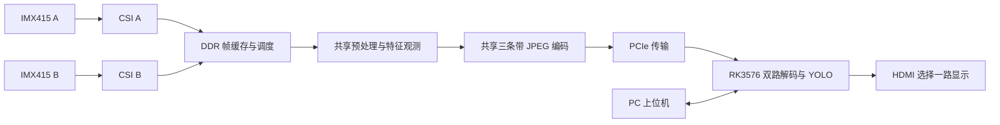

# 第二代：双路 CSI 采集与视觉检测

本工程在单路系统基础上改为双路 IMX415 输入。FPGA 对两路图像进行缓存、预处理和 JPEG 压缩，通过 PCIe 传给 RK3576；RK 同时处理两路视频，HDMI 选择其中一路显示，PC 上位机负责预览和控制。



## 主要功能

- 两路相机同时采集，利用 DDR 帧缓存和调度，按帧共享后续图像处理与 JPEG 编码资源。
- 支持灰度、高斯、CLAHE、高斯 + CLAHE、Sobel 引导增强和黑帽增强等预处理模式；当前双路 Sobel 模式不与 CLAHE 叠加。具体选项以位流能力和配套软件为准。
- 支持共享或独立设置两路 JPEG QF；独立控制需要位流支持，并由配套软件识别对应能力。
- FPGA 输出图像特征供 RK 和上位机使用。实验性自适应功能采用轻量决策树选择预处理，QF 和 YOLO 资源分配由暗部比例规则控制，主要用于展示和实验。
- RK 支持双路 YOLO 检测和 HDMI 单路选择输出；上位机提供双路预览、参数设置、性能状态和检测记录查看。

## 目录与工程入口

```text
.
├── DUAL_IMX415/
│   ├── dual_imx415_gray_demo.al      # TD 工程入口
│   ├── SOBEL_BUILD_NOTES_20261031.md
│   └── 双路独立QF说明.md
└── PC and RK system.zip             # PC/RK 工程和板端依赖归档
```

- FPGA 顶层模块：`dual_imx415_top`；目标器件：`PH1A90SEG324-2`；工程记录的开发软件版本：TD 2026.1 SP2。工程使用双 CSI 子卡对应的 37.125 MHz 相机时钟配置，实际使用时应核对硬件和初始化配置。
- [FPGA 工程目录](DUAL_IMX415/)、[Sobel 工程记录](DUAL_IMX415/SOBEL_BUILD_NOTES_20261031.md)、[双路独立 QF 说明](DUAL_IMX415/双路独立QF说明.md)。
- [PC 和 RK 工程包](<PC and RK system.zip>)包含 Windows 上位机、PC/RK 源码、模型与部分板端依赖、自适应模型训练记录及验证资料。包内说明记录了更具体的版本和部署方式。

## 使用流程

1. 将两路 IMX415 接至对应双 CSI 子卡，在 TD 中打开 `DUAL_IMX415/dual_imx415_gray_demo.al`，检查源文件、IP、引脚、时钟约束和实际板卡配置。
2. 使用当前源码完成构建，分别检查综合、布局布线和时序结果，烧录与配套软件匹配的位流；确认两路相机、PCIe 和 RK 解码链路正常。
3. 解压 PC/RK 工程包，先阅读其中的说明并备份板端现有文件。归档提供模型和部分依赖，但不是完整 RK 系统镜像；驱动、运行库和模型路径仍需与板端环境匹配。
4. 保留程序附带的 `_internal` 目录，运行 `pc/RKDualVisionHost/RKDualVisionHost.exe`，连接 RK 并检查两路预览、HDMI 输出和检测状态。
5. 根据已识别的位流能力设置两路预处理及 QF；如需独立 QF 或实验性自适应控制，在上位机启用对应选项并应用设置。

## 验证说明

- 项目以双路 1080P、60 FPS 视频采集和传输为目标；实际视频帧率受相机、图像内容、QF、PCIe 和 RK 负载影响。两路 YOLO 检测帧率需要单独实测，不能按视频帧率推定。
- 当前 HDMI 选择一路显示，不能据此认为已实现 HDMI 与 RK DSI 双屏同时显示。
- 自适应策略基于实验数据和规则，不保证在所有真实场景提高检测效果。建议记录画面、QF、检测帧率及显示帧率，再评估具体场景。
- 工程记录可能描述当时的候选版本；综合、时序和板测结果需要与实际源码、位流及构建报告逐一对应，不能直接将历史产物视为当前源码的验证结果。

更多项目背景见[仓库总说明](../README.md)。
