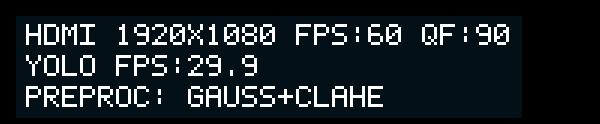

# RK左上角预处理显示与K1长按切换

部署日期：2026-10-10。已更新RK运行文件，并重启原HDMI+YOLO服务加载新版；不需要重新烧录FPGA bit。

## 操作

- K1短按并松开：沿用七档JPEG QF循环 `30→40→50→60→70→80→90→30`。
- K1持续按住约1.2秒：切换一次预处理模式，触发后继续按住不会连续切换；松开后才能再次触发。长按松开不会追加短按QF动作。
- 切换顺序：`GRAY→GAUSS→CLAHE→GAUSS+CLAHE→SOBEL→BLACKHAT→SOBEL+CLAHE→BLACKHAT+CLAHE→GRAY`。
- 当前起始为模式3，高斯+CLAHE；第一次长按切到Sobel。
- 灰度是增强分支共同的基础。黑帽仍为K3 gain1 +四方向line5，Sobel仍为T1 gain0.5。
- 60ms防抖、20ms GPIO轮询；若控制器启动时K1已经按住，则等第一次松开后才接受新按键。

## HDMI显示

左上角新增第三行 `PREPROC: GAUSS+CLAHE` 等实际模式名称，读取FPGA `0x100` 帧锁存生效模式，并验证CLH1/EHP1/EHP2标识。未知能力或无效值显示 `UNKNOWN`，不伪造成功切换。

第一行继续显示分辨率、静态FPS:60和实际QF，第二行继续显示YOLO实时FPS。三个组合名称中的 `+` 已增加字体字形。

状态图层由600×90扩大到600×124，沿用白色放大文字、25%不透明度背景、1Hz刷新；不在1920×1080视频帧上重绘该状态面板。按键控制器只写模式请求寄存器并等待SOF生效，不停止JPEG/HDMI/YOLO或重置码率选择。

上图来自新C程序绘制并提交的ARGB状态缓冲，导出时以黑色作底；不是完整HDMI截图。DRM实际读回plane165，ARGB8888，600×124，位置(0,0)，zpos2。

## 已完成验证

1. RK本机C编译通过，`-Wall -Wextra`无诊断；Python编译及shell语法检查通过。
2. [逻辑回放](logic_results.json)覆盖短按释放、长按持续5秒仅一次、按下抖动、20ms毛刺忽略、启动时按住忽略、跨阈值后才采到释放、两次独立长按。模式位图循环及跳过不支持模式检查通过。
3. [实际PCIe切换](live_results.json)在HDMI+YOLO持续运行时，调用与长按相同的 `cycle_preprocessing` 函数，完成 `3→4→5→6→7→0→1→2→3`。全部读回生效，QF始终90，预处理/raw/JPEG故障寄存器均0。
4. 状态图层日志依次读到4、5、6、7、0、1、2、3，均valid1，确认显示路径跟随实际生效值。
5. 新K1守护进程已读取GPIO47初始值1；旧遗留QF守护进程已停止，当前只有一个按键控制器。
6. 恢复模式3运行后，采样日志HDMI程序累计average约57.3 FPS，状态显示YOLO约29.9 FPS。该值对应当时场景，未做同场景前后性能矩阵；不能据此宣称严格60FPS或零丢帧。

实际手指按键的长短按反馈尚待用户确认。软件回放和PCIe切换测试不替代物理按键验收。K1接线沿用已确认的RK GPIO1_B7（Linux47），低电平按下。

## 文件与回滚

本地修改：FPGA项目 `deploy/jpeg_qf_button.py`；视觉项目 `rk_hdmi_status_plane.c`、`rk_font5x7.h`、`start_jpeg_hdmi_ai.sh`。原AI启动脚本后续会自动启动新版按键控制器和状态图层。按键QF动作由按下时触发改为短按松开触发，以区分长按。

RK运行文件位于 `/root/jpeg_rk`，安装前备份为 `/root/jpeg_rk/rollback_k1_preproc_20261010`，含旧控制脚本、状态源码及二进制、字体和启动脚本。二进制先编译、验证后原子替换；重新启动显示服务前原视频继续运行。安装日志：[install.log](install.log)。

本地包：[update.tgz](update.tgz)，10,241字节，传输核对SHA256 `cc54a65beb35140e99c67cdf6885f312b2d6a461cf9f00df550bb3a6f6a674d8`。RK实验目录 `/root/road_damage_yolov8n/k1_preproc_20261010`。

日志：`/root/jpeg_rk/qf_button.log`、`/root/road_damage_yolov8n/hdmi_status_plane.log`、`/root/road_damage_yolov8n/hdmi_ai_ui_fixed.log`。本次验证启用了JPEG_PAIR_DIAG和RK_STATUS_SNAPSHOT环境变量；普通启动未设置这些变量时，不生成状态缓冲图片或开启配对诊断。

新状态图层导出功能仅在设置 `RK_STATUS_SNAPSHOT` 时启用，第一次呈现或模式变化才写文件，不逐视频帧写盘。原模型、FPGA算法及QF90默认配置未修改。
