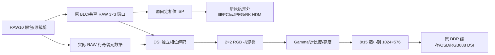

# DSI 偏色、棋盘格修正记录（DC16）

## 结论与证据边界

工程中已复现并修正一个会同时造成偏色和交替亮暗像素的 Bayer 行相位错误。
另增加 DSI 缩小前的抗混叠滤波。修正仅作用于 DSI 成像；原裁剪数据和 PCIe/JPEG ISP
输出与 2026-10-14 源码逐拍比较，保持一致。

这不能替代新 bit 的实物验收。目前板上运行的仍是旧 EHP2 设计。本文件区分
数值仿真、综合资源检查和现场检查，不把仿真结果写成板上效果。

照片中的 OSD 深蓝底仍呈蓝色，相机拍摄的蓝色桌面则明显偏黄。这是优先检查
相机 RAW→RGB 解码的辅助线索；拍照与现场光照未经校准，不能仅凭此排除物理 DSI 链路。

## 1. 找到的问题

`ui_image_correction.v` 的原计行逻辑：

- `v_cnt` 在 CSI 帧开始时清零。
- 空闲计数 `cnt` 是 17 位，遇到 RAW 有效数据清零，空闲时自由递增，帧开始不清零。
- `cnt == 10` 时增加 `v_cnt`；长消隐时还会在 131072 时钟后回卷。
- 输出只接受 `v_cnt > 0`，在 `v_cnt == 1` 的首个有效数据上产生 SOF。

因此，相同的 Bayer 原始帧，在不同帧首消隐时序下，可以从传感器第 0 行或第 1 行开始
保留。相邻两行的 CFA 排列不同，原 ISP 却固定使用 RGGB，未携带实际首行相位。

### 单变量复现实验

原测试的输入是 IMX415 GBRG RAW10 色块。仅延长第二帧前的空闲，使旧空闲计数器在
FS 附近经过 10，输入像素、RAW10 打包、分辨率和算法参数全部保持不变。
测试只等待自然计数，不 force DUT 内部信号。

| 输入与观察位置 | 正常相位 | 旧 RTL 在另一种消隐下 |
| --- | --- | --- |
| 纯红色块的去马赛克内部 RGB | `c81e1e` | `1ec81e`、`1e731e` 交替 |
| 纯红色块的 ISP RGB | `f26262` | `62f262`、`62ba62` 交替 |

这直接证明了“同一色块偏色并出现周期网格”的 RTL 缺陷。基线失败日志：
`evidence/fs_wrap_before.log`。照片中的具体偏色是否完全由这一缺陷引起，仍需烧录后确认。

IMX415 原始 GBRG 格式的参考依据是 Rockchip 官方内核驱动：
[imx415.c](https://github.com/rockchip-linux/kernel/blob/develop-5.10/drivers/media/i2c/imx415.c)。
实物模块的有效区起点、镜像或其他差异仍可通过新增的四种相位选择进行现场校准。

## 2. 修改结构

### 实际行相位跟踪

新增一个饱和到 10 的 RAW 空闲计数，识别真实 RAW 行而不受 4/5 有效节奏的一拍空隙影响。
该元数据计数在 FS 清零，在 SOF 锁存实际保留首行的奇偶。原 `cnt/v_cnt`、原裁剪输出
及旧 ISP 全部保留，避免改变 RK 输入。

DSI 另设插值输出，复用已有 RAW 窗口及行 RAM；新增元数据决定其行相位。
原 AWB 当前为固定单位增益，新 DSI 支路无需再复制其延迟 RAM。
DSI 保持 Gamma 2.2、对比度 140、亮度 +5。

新增 DSI Gamma 使用常量位平面多路选择和四级寄存器，输出数值及延迟与原
`ui_gamma(GAMMA_10x=22)` 一致。原 PCIe Gamma 未改动。这样避免为 DSI 的
12 个 8 位分量查表再分配 12 块大容量 ERAM。
TD 会主动把常量多路选择重新识别成 ROM，因此最终在查表数组上使用官方
SWUG106 第 4.3.15 节支持的 `rom_style="none"`，而不是依赖 RTL 的表面写法。
单独模块综合已确认 ERAM 为 0（`build/dsi_gamma_micro_final/`）。
实现方式依据：[本机安路 SWUG106 手册，第 61 页](F:/FPGA/AnLu/doc/SWUG/SWUG106_HDL_Coding_Synthesis_User_Guide.pdf)。

### 缩小前的抗混叠

原缩放是直接抽取像素和行。拍摄 LCD 子像素栅格、细密纹理时，这种抽取可能产生伪网格。
新增 2×2 RGB 平均在 Gamma 前进行，每个时钟仍处理 4 个像素，输入输出标志同步延迟两拍，
不产生反压。使用一行 512×96 位 RAM，有效存储 480×96＝46080 位。
该滤波会稍软化细节，可以通过 DSI 寄存器单独旁路，便于现场 A/B 比较。

DSI 面板时序仍为 1024×600，有效相机图像 1024×576，上下各 12 行黑边。
与 HDMI 1920×1080 相比，空间细节天然较少；新滤波不能提高面板分辨率。

## 3. 验证

日志位于 `build/dsi_color_diagnosis/`。

| 检查 | 结果 |
| --- | --- |
| 红/绿/蓝/灰色块，所有内部行、四个 lane 逐像素比较 | 通过 |
| CSI RAW10 的 4/5 有效节奏、第二帧稳定状态 | 通过 |
| FS 消隐/旧计数回卷复现条件，修正后相位 | 通过，内部色块错误数 0 |
| 原裁剪与冻结的 14 日源码逐拍比较 | 通过 |
| 原 ISP 与冻结的 14 日源码逐拍比较 | 三个短用例合计 760320 个像素完全一致 |
| 混合位宽读 FIFO → OSD → RGB 打包 → DSI 包 | 1024 像素、3072 payload 字节完全一致 |
| 抗混叠全帧单元验证 | 6220800 像素通过：棋盘格、RGB 渐变、旁路、气泡、帧边界 |
| CSI 完整两帧，每帧 1097 个传感器行，第二帧改变消隐相位 | 通过：去马赛克/DSI ISP 各 1080 行，缩放 576 行，内部色块错误数 0 |
| 上述完整链路的旧 ISP 输出逐拍比较 | 另有 4147200 个像素完全一致，合计 4907520 个 |
| TD 2026.1 SP2 完整展开、门级综合与物理实例合法性检查 | 通过，最终源码见 `build/dsi_resource_check.log` |
| DSI Gamma 与原 Gamma 逐拍比较 | 22116 个通道值，覆盖每通道全部 256 输入，以及有效气泡、复位和标志延迟，通过 |

完整链路日志：`build/dsi_color_diagnosis/full_frame.log`。
综合资源结果见下表及 `build/dsi_resources/gate.area`。
完整链路回归完成后，最终只为 DSI Gamma 查表数组补充了上述存储实现约束；
随后重新遍历全部 256 个输入值，确认数值及四拍时序与原 Gamma 完全一致。
仿真的 ISP 厂商 RAM 使用匹配 NOREG 同步读延迟的行为模型；关闭的动态 AWB 除法器使用未启用桩。
没有在仿真中复现 DDR 物理层、DPHY 电气层或 LCD 的实物特性。

运行入口：`tools/run_dsi_color_diagnosis.ps1 -FullFrame`。冻结参考源码：
`sim/reference_20261014/legacy_reference.v`，SHA256：
`f5362ea1c56d042398140d4027dacdd05992031fb37ba1d9dd672dfaaaf2664d`。

### 最终源码综合资源

同为 PH1A90SEG324-2、TD 2026.1 SP2，以下均比较门级综合报告，未混用布局布线结果。

| 资源 | 14 日旧工程 | DC16 最终源码 | 器件总量 / 新占用率 |
| --- | --- | --- | --- |
| Slice | 47831 | 49207 | 64320 / 76.50% |
| LUT | 59248 | 60815 | 综合统计 |
| 寄存器 | 46032 | 47553 | 综合统计 |
| ERAM20K | 256 | 256 | 272 / 94.12% |
| DSP | 122 | 134 | 240 / 55.83% |

DSI 抗混叠单独使用 5 块 ERAM，DSI Gamma 使用 0 块。综合器也重新选择了其他自动推断
存储的 LUT/ERAM 映射，因此总数不能简单按模块增量相加。早期未加有效约束的版本曾用满
272 块，最终通过 `rom_style="none"` 避免了这个问题。中间结果仅作为排查证据保留在
`evidence/resource_before_*.area`；最终结果以 `build/dsi_resources/gate.area` 为准。

最终日志包含 `DSI_RESOURCE_CHECK_PASS`，已完成 `legalize_phy_inst` 和门级数据库导出。
旧 IP 的告警仍存在，包括旧版也有的 5 条 DPHY ODDR 复位同步告警；未据此认定实物偏色原因。
本轮未运行布局布线、最终 setup/hold 检查或 bit 生成，最终资源与时序仍须以新 bit 构建报告为准。
如后续加入 ChipWatcher 等调试逻辑，还会额外消耗资源。

## 4. 已完成的现场读取

2026-10-16，通过 COM12、1500000 波特读取 RK。PCIe 端点存在于
`/sys/bus/pci/devices/0000:21:00.0/resource0`。

| BAR 偏移 | 读值 | 含义 |
| --- | --- | --- |
| 0x44 / 0x48 | 1920 / 1080 | 原灰度 DMA 尺寸 |
| 0x5c | 0x47520005 | 原 ABI |
| 0x94 | 0 | 原采集错误计数，本次读取时为零 |
| 0xa4 / 0x100 | 3 / 3 | 高斯 + CLAHE 请求/已应用 |
| 0xac / 0x104 | 0x45485032 / 0xff | EHP2、八种预处理支持 |
| 0x108 | 0 | 尚无 DC16 标识，不能操作新 DSI 寄存器 |

运行中的 RK 显示进程及预处理模式没有被停止或修改。上述旧寄存器没有 RAW/RGB 样本，
因此这次读取无法直接判定当前实物的 Bayer 相位或 DSI 像素颜色。

### 为什么 HDMI 更清楚，仍不能证明相机 RGB 解码正确

两路的显示条件不同：RK HDMI 处理的是 1920×1080 灰度/JPEG 数据，本次读回的前处理为
高斯 + CLAHE；DSI 处理的是独立 RGB 支路并缩小到 1024×576。灰度、高斯和 JPEG 可能
减弱部分彩色采样干扰，DSI 的直接抽样则可能增加混叠。因此 HDMI 的主观清晰度不能
作为 Bayer 相位正确的证据，采集错误计数为 0 也不能证明颜色解释正确。

本轮通过 RK 读取和控制 FPGA 用户 BAR；DSI 像素生成、DDR 缓存、打包及输出仍全部在 FPGA。

已通过串口放置 `/root/jpeg_rk/dsi_control_dc16.py`，PC/RK 文件 SHA256 一致：
`b9c8ea33434a77a89aeb7abbc2ed612bb68c50aa041d20caaac19ac806a0aaa7`。
已在当前旧 bit 上执行只读检查，按设计返回 `DC16 bit required ... Nothing written.`，
未写入 FPGA 控制寄存器。

## 5. 新 bit 的最小验收

1. 用**本文件夹** `fpga_prj_jpeg.al` 重新综合、布局布线并生成 bit，检查最终 setup/hold
   时序后烧录。旧 bit 保留在 14 日工程，不要用旧工程的 best_result 替代新构建。
2. 本轮 RK 已安装辅助脚本。进入 `/root/jpeg_rk`，执行 `python3 dsi_control_dc16.py`。
   必须读到 DC16；默认自动相位、抗混叠开启、彩条关闭。
3. DSI 左上角 FPS 右侧应有红、绿、蓝、白参考块及青色下划线。此处绕过相机和 DDR，
   若这些颜色不正确，继续定位 DSI 打包/DPHY/面板；不能以相机算法解释。
4. `python3 dsi_control_dc16.py --bars on` 检查全屏白、黄、青、绿、品红、红、蓝、黑彩条。
   结束后 `python3 dsi_control_dc16.py --bars off`。
5. 保持同一个场景比较自动相位的画面；若仍偏色，可以无须重新综合地比较
   `--bayer RGGB`、`--bayer GBRG`、`--bayer BGGR`、`--bayer GRBG`，记录状态和实拍结果。
   建议同时放一个实际蓝色或红色物体，区分屏幕采样伪色与整个色彩通路偏色。
6. `--filter off` / `--filter on` 只改变 DSI 抗混叠，观察网格与细节取舍。
   `--restore-default` 恢复自动相位 + 滤波开启 + 彩条关闭。

此轮没有自动生成/烧录新 bit。最终的颜色、网格和实际显示帧率，须完成上述上板验收。
FPGA 重新配置后，RK 侧按原部署流程恢复 PCIe 枚举和原显示程序。

### 实物结果如何判定

| 单次只改变的变量 | 成功或失败信号 | 下一步 |
| --- | --- | --- |
| 仅开启标准彩条 | 标准颜色准确、无周期方块 | 继续检查相机支路 |
| 仅开启标准彩条 | 参考颜色也错或方块仍在 | 检查 DSI 打包、DPHY、面板配置与物理链路 |
| 同一场景仅切 Bayer 相位 | 某一相位恢复红/蓝/灰色且去除交替网格 | 记录相位和 0x110 读值，核对相机有效区起点 |
| 正确相位下仅切滤波开关 | 网格减弱，颜色关系保持 | 比较细节软化程度，决定保留滤波还是旁路 |
| 正确相位下仅切滤波开关 | 网格无变化 | 继续区分相机拍屏摩尔纹、RAW 解包和物理链路问题 |

每组比较保持场景、相机位置和曝光不变，保存 DSI 实拍图与脚本状态输出。

### DSI 专用 BAR

| 偏移 | 功能 |
| --- | --- |
| 0x108 只读 | 0x44433136，DC16 |
| 0x10c 读写 | bit0 手动相位；bit1 行相位翻转；bit2 交换 R/B；bit3 滤波旁路；bit4 全屏彩条 |
| 0x110 只读 | bit0 已应用相位翻转；bit1 已应用 R/B 交换；bit2 保留首行是传感器奇数行 |

DSI 参数在帧边界生效，原 EHP2 寄存器含义不变。彩条产生于 DDR 后，不能用它单独证明 DDR 搬运无误。
