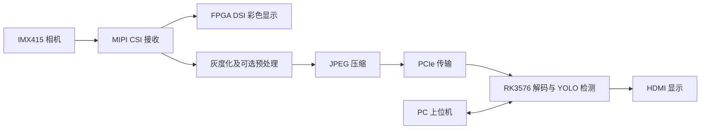

# 第一代：单路 CSI 采集与 DSI 显示

本工程是面向道路裂缝检测的单路视觉系统。FPGA 接收 IMX415 相机画面，分别送往本地 DSI 彩色显示通路和图像压缩传输通路；RK3576 接收图像后进行 YOLO 检测，并通过 HDMI 输出画面和检测结果。



## 主要功能

- 单路 IMX415 图像采集；FPGA 直接驱动 DSI 屏幕显示彩色相机画面。
- 另一条处理通路提供灰度、高斯、CLAHE、高斯 + CLAHE、Sobel 引导增强、黑帽增强，以及增强后叠加 CLAHE 等模式。具体可选模式需与烧录位流和控制软件对应。
- 图像经 JPEG 压缩、PCIe 传输至 RK3576，由 RK 解码并运行 YOLO 裂缝检测；HDMI 画面可叠加检测框及状态信息。
- PC 上位机提供画面预览和运行控制。FPGA DSI 与 RK HDMI 是两条不同的显示通路。

## 目录与工程入口

```text
.
├── FPGA-RTL project/
│   ├── fpga_prj_jpeg.al       # TD 工程入口
│   ├── README.md              # DSI 修正的技术记录
│   └── DSI_FIX_20261016.md   # DSI 修正记录
└── PC and RK system.zip      # PC/RK 增量部署包
```

- FPGA 顶层模块：`system_top`；目标器件：`PH1A90SEG324-2`；工程记录的开发软件版本：TD 2026.1 SP2。
- [FPGA 工程目录](<FPGA-RTL project/>)、[DSI 技术说明](<FPGA-RTL project/README.md>)、[DSI 修正记录](<FPGA-RTL project/DSI_FIX_20261016.md>)。
- [PC 和 RK 部署包](<PC and RK system.zip>)包含 Windows 上位机、RK 端更新文件、源码、回退文件和验证记录。包内 `README.md` 和 `REPORT.md` 记录了具体内容及部署方式。

## 使用流程

1. 按实际硬件连接 IMX415、FPGA、DSI 显示屏及 RK，在 TD 中打开 `FPGA-RTL project/fpga_prj_jpeg.al`。检查源文件、IP、引脚与时钟约束，并根据当前源码完成构建和时序检查。
2. 烧录与工程及硬件匹配的位流，确认 FPGA 本地 DSI 画面正常；再确认 RK 的 PCIe、视频解码和 HDMI 显示链路正常。
3. 解压 PC/RK 部署包，先阅读包内说明并备份板端现有文件。该包是**增量部署包**，依赖 RK 原有模型、库、PCIe 驱动和运行环境，不是完整系统镜像。
4. 使用包内 `launch.cmd` 启动上位机，连接配套 RK 软件，检查预处理模式、画面及检测结果。

## 验证说明

项目以 1080P、60 FPS 视频链路为目标，实际表现取决于位流、硬件连接和运行负载；视频帧率与 YOLO 推理帧率应分别查看。DSI 文档记录的是对应时间点的修改及验证状态，使用其他版本时请结合实际构建报告与板上结果核对；仓库中已有的历史位流不应默认视为与当前源码一致。

更多项目背景见[仓库总说明](../README.md)。
